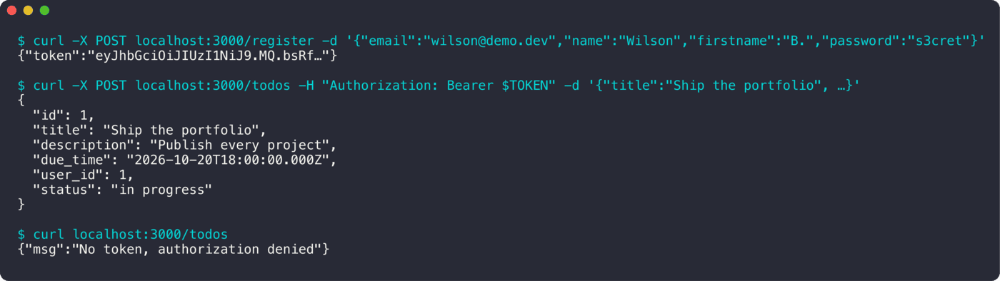

<div align="center">

# EpyTodo

**Une API REST de to-do list, avec authentification JWT.**

   

<sub>Projet à 2 · 2023</sub>

</div>

<br/>

<p align="center"></p>

## Le projet en quelques mots

Notre première API web : des utilisateurs, des tâches, et une authentification par token. Les mots de passe sont hachés, les routes sont protégées, et on a ajouté en bonus une petite interface web.

## Ce que ça fait

- Inscription et connexion (`/register`, `/login`), mots de passe hachés avec **bcrypt**
- Routes protégées par **JWT**
- CRUD des utilisateurs (`/user`, `/users/:id`) et des tâches (`/todos`, `/todos/:id`, `/user/todos`)
- Schéma MySQL fourni (`epytodo.sql`)
- Bonus : interface web (inscription, connexion, liste et suppression des tâches)

## Lancer le projet

```bash
mysql -u root -p epytodo < epytodo.sql
cd my_app && npm install && node src/index.js
```

## L'équipe

<a href="https://github.com/Wilson-Epitech/epytodo/graphs/contributors"></a>

Yanis Harkouk, Wilson Bordichon

**Ma partition :** J'ai monté le **serveur Express** et la structure du projet, les routes des **tâches**, l'inscription, la suppression d'utilisateurs, le **schéma SQL** et l'**interface web** bonus.
